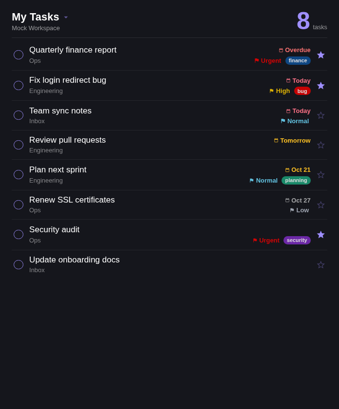

# ClickUp Tasks — iCUE Widget for Xeneon Edge

[](https://github.com/joshuawowk/icue-widget-clickup/releases)
[](LICENSE)

A glanceable, **My Day**-style ClickUp task list for the CORSAIR Xeneon Edge. Dark theme, circular checkboxes, due-date chips (Overdue / Today / Tomorrow), priority stars, and the list each task belongs to — designed to mirror the Microsoft To-Do Android widget aesthetic.



## Features

- **Direct ClickUp API connection** — no companion service needed; just your personal API token
- **Interactive (touch)**:
  - Tap the **header** → reveal the filter bar and toggle which **statuses** and **priorities** to show (multi-select chips)
  - Tap a task → details view with the full **description** (read-only, line breaks kept, scrolls if long), its populated **fields** (assignees, start date, time estimate, sprint points, created, plus every filled-in custom field — drop-downs show their color dot), **tags**, the list's **status** pills and **priority** pills (Urgent / High / Normal / Low / None) — tap a status or priority pill to change it (PUT to ClickUp; priority updates instantly, with a toast, and reverts if ClickUp rejects it)
  - Tap a task with **subtasks** → the details view lists them with an *X of Y done* progress count; completed subtasks are dimmed and struck through, and you can tap a subtask's circle to quick-complete it (same **Undo** toast)
  - Tap a task's circle → quick-complete with a 3-second **Undo** toast before it commits
  - Task list scrolls by touch when it overflows
- **My Tasks mode** (default): every open task assigned to you across the workspace, ordered by due date then priority
- **List mode**: point it at a single ClickUp list via List ID
- **Every page of tasks**: ClickUp returns 100 tasks per page; the widget follows `last_page` (up to 10 pages / 1,000 tasks) for the task list and for subtask lookups, so large accounts are no longer truncated to the first 100
- **Filters**:
  - **Due**: all open tasks, due today + overdue, or due this week
  - **Priority**: in-widget multi-select chips (Urgent / High / Normal / Low / None), seeded by a **Priority (default)** setting (All / Urgent only / High and up / Normal and up)
  - **Status**: in-widget multi-select chips built from your tasks' actual statuses. In **List mode** the chips follow the list's configured status order. A **Default Status** setting (a status name, e.g. `In-Progress`; blank = all) chooses which chips start selected
  - Chips are independent toggles — selecting none *or* all of a row means "show everything" for that row; an accent dot by the header shows when a filter is narrowing the list
- **Due chips**: red *Overdue*, pink *Today*, amber *Tomorrow / this week*, muted dates beyond
- **Priority stars**: filled accent star for `urgent` / `high` tasks
- **Priority and tags in every row**: a small flag + label in the ClickUp priority color (only when a priority is set), and up to three tag chips in the tag's own ClickUp color with a `+N` overflow
- **Rows use the full width**: the due chip sits right-aligned beside the task name (names wrap to two lines), and priority + tags line up on the right of the list name; anything that doesn't fit wraps underneath, still right-aligned, so rows stay tidy at every Xeneon Edge size
- **Offline resilience**: keeps showing the last good data with an `offline` tag if the network drops
- **Responsive**: all Xeneon Edge slot sizes — S/M/L/XL, horizontal (multi-column on L/XL) and vertical
- **Personalization**: text/accent/background colors, background image with glass blur, transparency

## Android version

An Android home-screen widget with the same function and look — Material You or the ClickUp dark look,
resizable, per-widget settings, quick-complete with Undo, filters and task details — lives in
[`android/`](android/README.md).

## Install

### Prerequisites

- Windows PC with **iCUE 5.52 or newer** (the widget declares `min_app_version` 5.52)
- A **CORSAIR Xeneon Edge** (the widget targets the `dashboard_lcd` device)
- A **ClickUp** account and a personal API token (see [Setup](#setup))
- Internet access to `api.clickup.com` (declared as a `url` permission in `manifest.json`; iCUE shows it for approval on install)

### From a release (recommended)

1. Download [`ClickUp-Tasks-1.5.1.icuewidget`](https://github.com/joshuawowk/icue-widget-clickup/releases/download/v1.5.1/ClickUp-Tasks-1.5.1.icuewidget) from the [GitHub Releases](https://github.com/joshuawowk/icue-widget-clickup/releases) page. Release tags are `vX.Y.Z` for this iCUE widget; tags starting `android-v` belong to the Android app, so always use a `v` release.
2. Double-click the `.icuewidget` file, **or** open iCUE → **Widgets** → **+** and select the file.
3. Add the widget to a Xeneon Edge slot and continue with [Setup](#setup).

The link above is pinned to a version. To get a newer widget build, pick the latest `v` release on the Releases page and download the `ClickUp-Tasks-<version>.icuewidget` asset.

### Build from source

Needs [Node.js](https://nodejs.org/) and the official CLI (`npm install -g icuewidget-cli`).

```
npm run validate   # icuewidget validate .
npm run package    # stages the widget files and runs icuewidget package -> dist/ClickUp-Tasks-<version>.icuewidget
```

Do not run `icuewidget package .` in the repo root: it zips every non-hidden file, including `android/` and `dev/`. `npm run package` stages only the files the widget loads. Then install the file from `dist/` as above.

## Setup

1. In ClickUp: avatar → **Settings** → **Apps** → copy your **API Token** (starts with `pk_`)
2. In iCUE: add the widget to a Xeneon Edge slot → open widget settings → paste the token into **ClickUp API Token**
3. Optional: set a **List ID** (the number in a ClickUp list URL) to show one list instead of all assigned tasks

## Settings

| Setting | Type | Default | Description |
|---------|------|---------|-------------|
| ClickUp API Token | text | — | Personal token (`pk_…`) |
| List ID | text | empty | Blank = all tasks assigned to you |
| Title | text | `My Tasks` | Header label |
| Show | dropdown | All open tasks | All / Due today + overdue / Due this week |
| Priority (default) | dropdown | All priorities | Seeds the priority chips: All / Urgent only / High and up / Normal and up |
| Default Status (blank = all) | text | `In-Progress` | Status name(s) to pre-select (comma-separated). Blank or no match = all selected |
| Max Tasks | slider | 12 | 3–30 |
| Refresh Interval | slider | 5 min | 1–30 min |
| Text / Accent / Background Color | color | white / `#9f8fff` / `#15161c` | |
| Background Image + Glass Blur | media | — | Optional backdrop |
| Background Transparency | slider | 100% | 0 = desktop shows through |

## States

- **Loading** — spinner while fetching
- **Setup** — no token configured; shows where to find one
- **Empty** — "All clear" when there are no open tasks at all
- **Filtered to zero** — when tasks exist but the active filters hide them all, the list shows an inline "No tasks match the current filters" note and the filter bar stays open so you can adjust
- **Error** — invalid token or network failure (falls back to last good data when possible)

## Privacy

The widget talks **only** to `https://api.clickup.com` over HTTPS using your token (GET for reading, PUT only when you change a status or priority). No other endpoints, no analytics, no storage outside iCUE widget settings.

## Roadmap

- Tag / space filters (status + priority filters shipped in v1.2.0)
- Create task from the widget
- Edit tags and custom fields (shown read-only since v1.4.0; priority editing shipped in v1.4.0)

## License

MIT — see [LICENSE](LICENSE).
