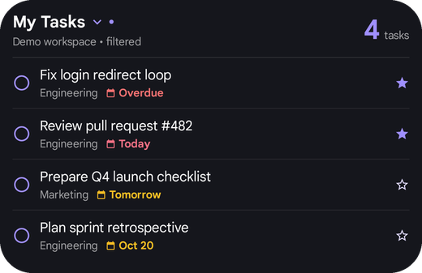
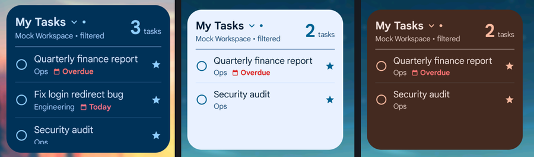
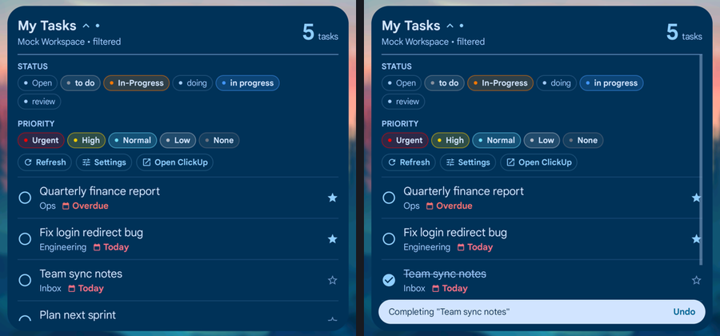
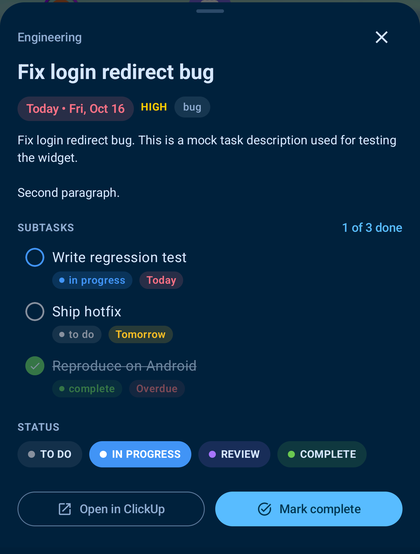
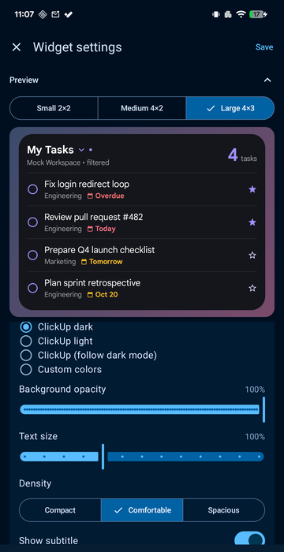

# ClickUp Tasks — Android home-screen widget

The Android sibling of the iCUE widget in the repo root: a glanceable, **My Day**-style list of your
open ClickUp tasks on your home screen, with the same look and behaviour — circular check circles,
due chips (Overdue / Today / Tomorrow), priority stars, list names, a status/priority filter bar,
quick-complete with Undo, and a task detail view with subtasks and status changes.

Built with Jetpack Glance (Compose for widgets), WorkManager and Material 3. Talks directly to the
ClickUp API with your personal token — no companion service.



**System (Material You)** — follows your wallpaper palette and light/dark mode live:



| Filter bar · quick-complete with Undo | Task details | Per-widget settings with live preview |
|---|---|---|
|  |  |  |

## Features

- **Same function and form as the iCUE widget** — header with title, workspace and task count;
  due chips; priority stars; list names; "+N more"; offline fallback to the last good data
- **Interactive**
  - Tap the **header** → Refresh / Settings / Open ClickUp, and **Status** + **Priority** multi-select chips
    (same semantics as iCUE: all or none selected = show everything; an accent dot marks an active filter)
  - Tap a task's **circle** → quick-complete with an **Undo** bar before it's sent to ClickUp
  - Tap a **task** → details sheet: description, due date, priority, tags, **subtasks** (X of Y done,
    quick-complete with Undo) and **status pills** to change the task's status; Open in ClickUp
- **My Tasks** (everything assigned to you) or a **single list** (picked from your workspace, or by List ID)
- **Per-widget settings** — every widget instance has its own source, filters and style
- **Resizable** from 2×2 upward; the layout adapts (narrow widgets drop list names/stars, short ones the subtitle)
- **Style**
  - **System (Material You)** — follows your wallpaper colors and light/dark mode (Android 12+; this is
    not Pixel-only — any Android 12+ phone with dynamic color works, though OEM palettes vary)
  - **ClickUp dark / light / follow dark mode** — the iCUE look
  - **Custom** text / accent / background colors
  - Background opacity, text size (80–140 %), row density, optional background image with blur,
    and toggles for subtitle, count, list names, due chips and stars
- **Refresh** every 15 / 30 / 60 / 120 min (Android's background minimum is 15 min) and on demand
- **States** like the iCUE widget: loading, setup (no token), all clear, filtered-to-zero, error
  (a rejected token says so and opens the app), and `• offline` with the last good data on network errors
- Works on any launcher — tested on **Microsoft Launcher** (pin from the app, resize handles, its own
  widget *Settings* menu) — and on Pixel Launcher; Android 12+ launchers also offer *Widget settings*

## Install

Sideload the APK (Settings → enable *Install unknown apps* for your browser/files app), or build it:

```bash
cd android
./gradlew assembleRelease        # app/build/outputs/apk/release/app-release.apk
adb install -r app/build/outputs/apk/release/app-release.apk
```

Requires Android 8.0+ (API 26). Material You colors need Android 12+.

## Setup

1. Open **ClickUp Tasks** → paste your **API token** (ClickUp → avatar → **Settings** → **Apps** →
   **API Token**, starts with `pk_`) → **Connect**. Or flip on **sample tasks** to try it without an account.
2. Add the widget: long-press an empty spot on your home screen → **Widgets** → **ClickUp Tasks**
   (or use **Add widget to home screen** in the app, where the launcher supports it).
3. Pick what it shows and how it looks (live preview at the top). Re-open the settings any time:
   tap the widget's title → **Settings**, use your launcher's widget settings, or open the app.

## Privacy

The app talks **only** to `https://api.clickup.com` (GET to read, PUT only when you complete a task or
change its status). The token is encrypted with an Android Keystore key, kept in app-private storage,
and excluded from backups. No analytics.

## Development

- Toolchain: JDK 17/21, Android SDK 36, AGP 9, Kotlin 2.3 (`./gradlew assembleDebug testDebugUnitTest`)
- `tools/mock_clickup.py` — a local mock of the ClickUp endpoints for device testing (debug builds only):

  ```bash
  python3 tools/mock_clickup.py &            # token: pk_test_token
  adb reverse tcp:8765 tcp:8765
  adb shell run-as net.jwowk.clickupwidget.debug sh -c \
      'echo http://127.0.0.1:8765/api/v2 > files/api_base_override.txt'
  ```
- Release signing reads `android/keystore.properties` (gitignored); without it the release build is debug-signed.
- The release build is minified with R8 — test it on a device too (`proguard-rules.pro` keeps the Glance
  `ActionCallback` constructors that Glance instantiates reflectively; without that rule every widget tap
  silently does nothing in release only).
